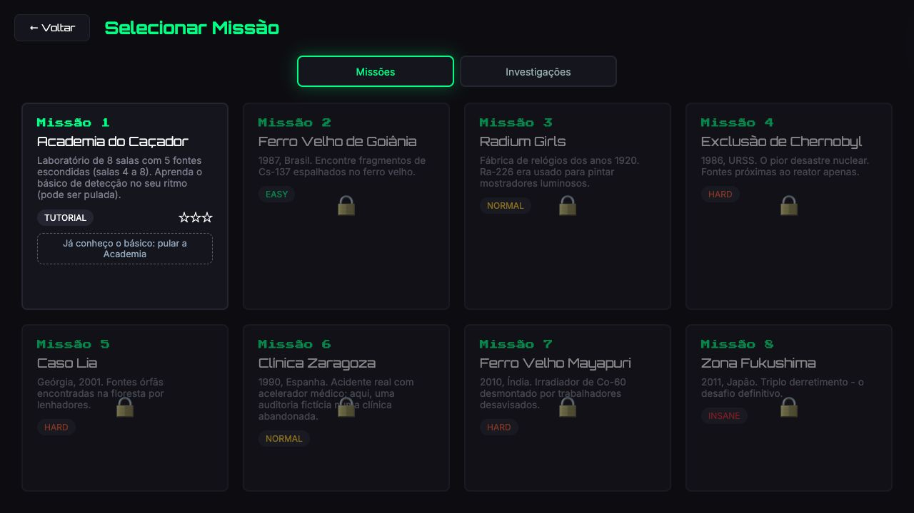
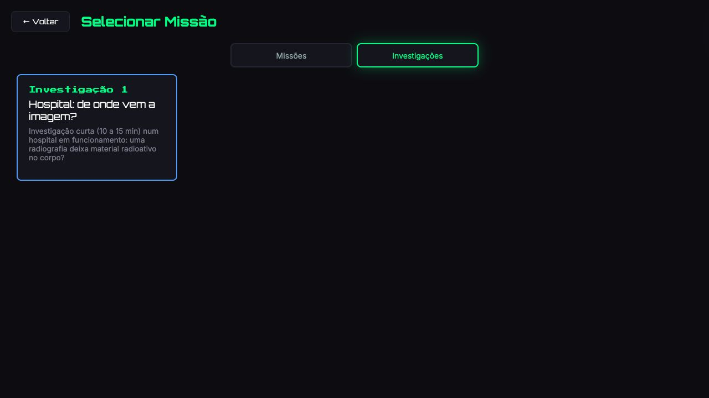
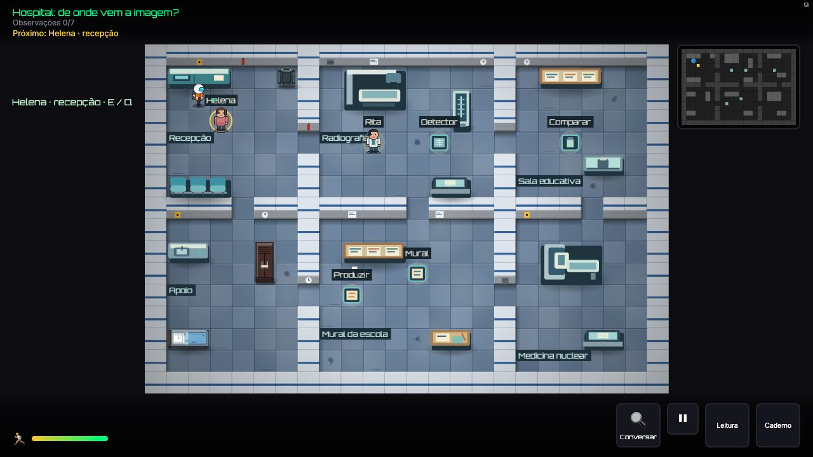
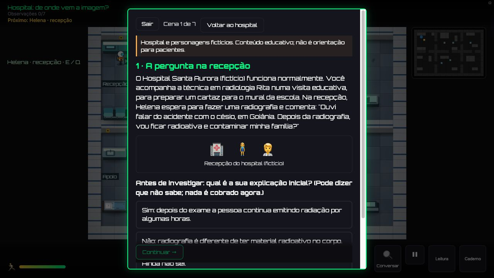
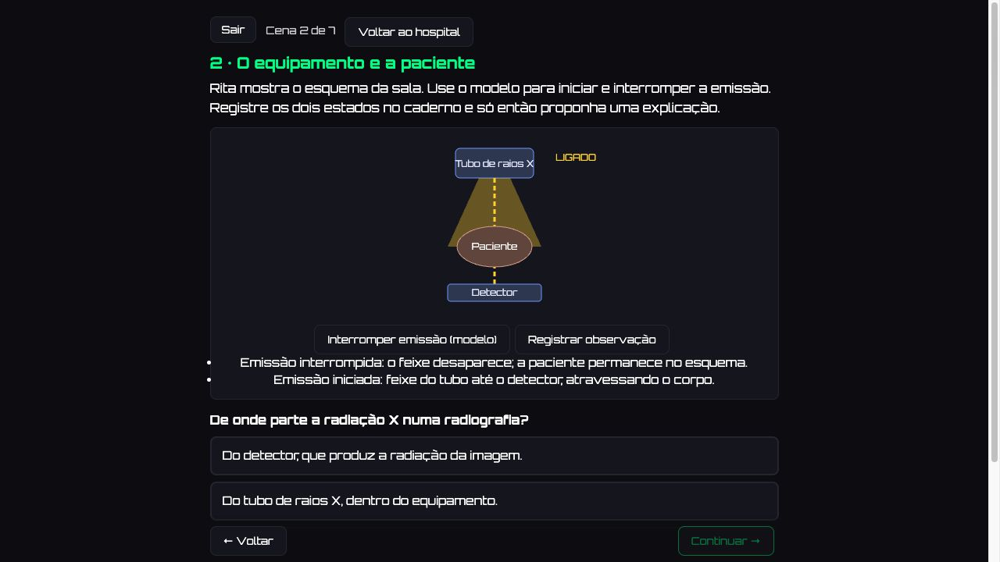
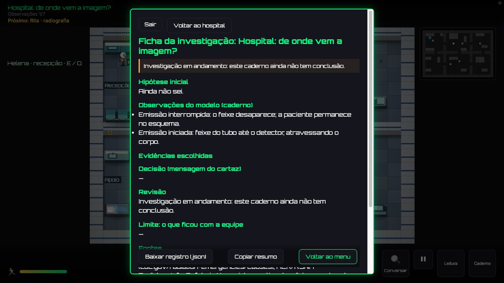
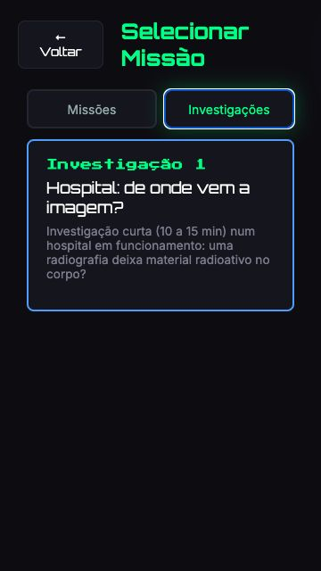
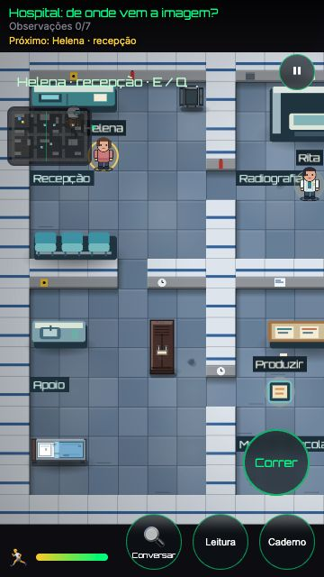
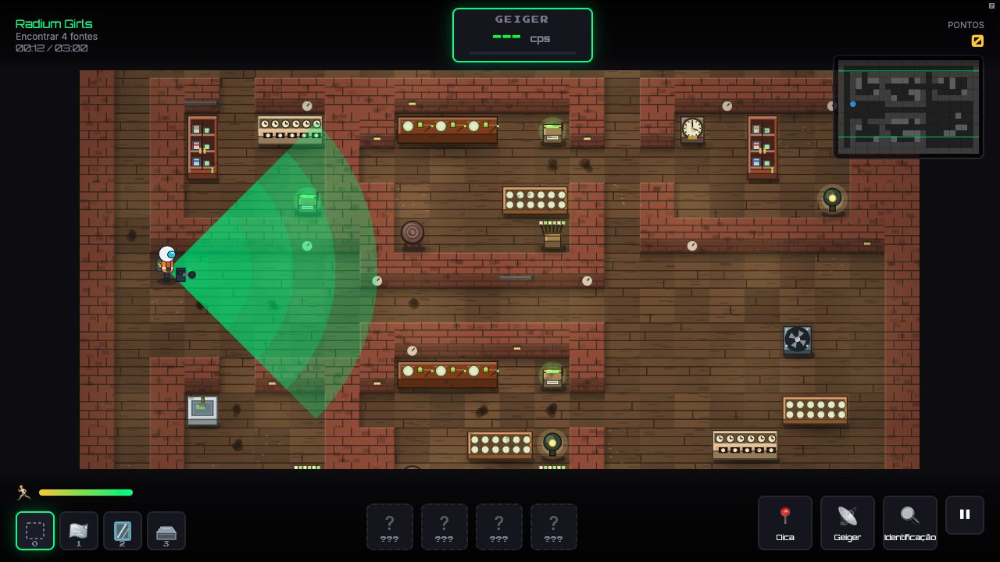
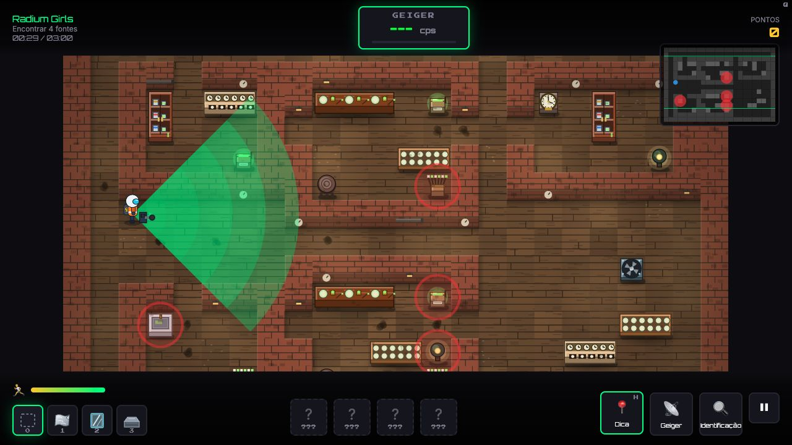

# Radiation Hunters 2.4 — revisão e próximos episódios

Revisão em 19/10/2026. Fonte examinada: `/Volumes/EXBOM/LabVirtualGC/apps/radhunter/current/`. O jogo não foi alterado nesta revisão. Foram produzidos inventário, diferenças de arquivos, capturas atuais e log de testes.

## Parecer

As mudanças fortalecem a apresentação e o uso do jogo: a separação entre missões e investigações ficou explícita, o desenho dos móveis está mais próximo da área que bloqueiam, as blindagens ganharam símbolos próprios e a localização assistida reduz o risco de a busca dominar a experiência. A estrutura original de mapas e controles foi preservada.

A expansão por episódios faz sentido. A próxima dependência é pequena, mas essencial: separar a infraestrutura comum da configuração do hospital. Hoje o menu consegue listar conteúdos de um cadastro, mas a inicialização do campo e parte da interface ainda assumem que toda investigação é o hospital de sete cenas. Acrescentar uma segunda entrada ao cadastro, sozinho, não cria um segundo episódio funcional.

Robustez técnica, qualidade da experiência e aprendizagem são dimensões diferentes. Os resultados abaixo não demonstram eficácia pedagógica em turma.

## 1. O que mudou desde a versão revisada

Comparação de `current/` com `archive/2026-10-19_pre-abas-dica.tar.gz`, complementada pelos hashes da entrega 2.3 em `docs/conferencia-2026-10-16/alteracoes-2.3.json`. O backup pre-abas não contém a árvore dos testes; por isso o inventário não classifica esses arquivos como novos apenas por estarem ausentes do backup.

| Área | Mudança verificada | Consequência |
| --- | --- | --- |
| Seleção | Abas Missões/Investigações em `index.html`, `styles.css` e `ui.js` | Missões é o destino padrão do menu; sair da investigação retorna à aba correspondente. |
| HUD hospitalar | Ocultação de `#sources-tracker` no hospital | O cabeçalho mantém o progresso sem o contador central duplicado; conferido em 360 × 640. |
| Localização assistida | Novo `encontros/dica.js` e integração na `GameScene` | Após 90 s sem progresso, minimapa; após 150 s, mapa também. Pedido manual dura 8 s. Esses tempos são decisões de projeto. |
| Aproveitamento | Desconto por dicas de nível 2 | Dois pontos por intervalo cobrado; teto de seis. Resumo final informa o desconto. A política também se aplica ao modo estudo. |
| Blindagens | SVGs próprios em lugar dos emojis antigos | Folha de alumínio, painel de acrílico e lingote de chumbo têm representações diferentes; nomes e espessuras permanecem nos títulos dos botões. |
| Mobiliário | `estilo-rpg.js`, `moveis-rpg.js`, `moveis-rpg-interior.js`, `moveis-rpg-ruinas.js` | Contorno, paleta, volume, sombra e desgaste determinístico; despacho por tema e tipo. |
| Renderizador | `moveis.js` chama o desenho RPG antes das rotinas anteriores | Integração na API existente; desenhos hospitalares específicos continuam disponíveis. |
| Idiomas e versão | Chaves novas PT/EN e identificação 2.4 | Textos das abas, dicas e desconto aparecem nos dois idiomas. |
| Testes e ferramentas | Testes das dicas e ferramentas de catálogo/comparação presentes | Há verificações de limiares, custo, botão, desenho da dica e telas pequenas. |

Contagem feita diretamente no código atual: **69 chaves de desenho RPG cobrem os 70 descritores de móveis dos seis temas**. Uma chave genérica pode cobrir mais de um descritor. Os **11 móveis específicos da investigação hospitalar** continuam em `mobiliario-hospital.js`, uma família própria de desenho. O número “5 pilotos + 52 tipos” do README descreve o histórico da implementação, não essa contagem atual.

Pelos hashes comparáveis, `hospital.js`, `hospital-campo.js`, `motor.js` e `ui-investigacao.js` permanecem iguais à entrega 2.3. Portanto, a atualização 2.4 fortaleceu principalmente a infraestrutura visual e de navegação; não acrescentou outro episódio nem outro modelo de investigação.

## 2. Percurso observado nesta revisão

Capturas abaixo são desta revisão, não de verificações anteriores. O início foi pelo menu, em português. Para examinar o modelo foi usada a alternativa Leitura depois da conversa inicial no campo. O percurso manual não percorreu as sete etapas até o fim; a suíte automatizada verifica esse caminho.

### Etapa 1 — Seleção das missões: funcional

As oito missões aparecem na aba padrão. A separação visual ficou clara. Cartões bloqueados permanecem com texto de contraste baixo; isso merece revisão de legibilidade se a descrição precisar ser lida antes do desbloqueio.

### Etapa 2 — Entrada nas investigações: funcional, com ajuste de teclado pendente

A aba mostra o hospital sem competir com os cartões das missões. Sair da investigação devolve o usuário a essa aba. Entretanto, pressionar ArrowLeft sobre a aba Investigações não mudou a seleção. O código implementa clique e `aria-selected`, mas não a navegação por setas/Home/End nem a relação entre abas e painéis. Isso é uma lacuna do padrão de abas, não prova de inacessibilidade global.

### Etapa 3 — Hospital em campo: coeso com o jogo

A planta, personagem, minimapa e ações foram mantidos. Os móveis comuns refeitos em RPG aparecem junto dos equipamentos próprios do hospital. É uma base adequada para variar ambientes sem trocar a estrutura do jogo.

### Etapa 4 — Hipótese: funcional; apresentação pode acompanhar melhor o mapa

A conversa com Helena abre sobre o cenário. “Ainda não sei” é uma opção explícita, e o registro aparece depois no caderno. O painel ainda usa emojis de pessoas, enquanto o campo tem sprites próprios. Substituí-los pelos mesmos retratos/personagens do jogo seria um refinamento de consistência, não uma mudança de mecânica.

### Etapa 5 — Observação antes da interpretação: funcional

No modelo, as alternativas só apareceram depois do registro dos dois estados. O modelo continua identificado como didático. É importante preservar essa distinção nos próximos episódios: uma animação que representa uma emissão não deve ser apresentada como medida de um aparelho real.

### Etapa 6 — Caderno parcial: funcional

O caderno mostrou “Ainda não sei”, as duas observações, os campos ainda sem resposta e o aviso de investigação em andamento. Exportação e cópia estão disponíveis. O registro não é uma avaliação automática de uma explicação escrita.

### Etapa 7 — Seleção em 360 × 640: funcional

As duas abas e o cartão couberam na tela. O foco visual na aba selecionada ficou perceptível. O teste é em viewport de navegador; não substitui teste em aparelho físico.

### Etapa 8 — Hospital em 360 × 640: funcional, com oclusão do cenário

O contador duplicado saiu e os três botões inferiores couberam. O mapa usa a câmera existente. O botão Correr ainda encobre parte dos rótulos do cenário; o minimapa também ocupa área do mundo. Isso não é o mesmo problema da sobreposição antiga do contador. Para cenas futuras, convém reservar áreas de leitura/interação longe dos controles sobrepostos.

### Etapa 9 — Fábrica com móveis RPG: funcional

A missão 3 foi aberta pelo endereço do modo professor, em modo estudo, sem completar a missão ou liberar progresso por conclusão. Bancadas, bandejas, potes e armários mantêm a organização do mapa e ganharam desenhos reconhecíveis. Os novos ícones de blindagem aparecem no HUD.

### Etapa 10 — Dica manual: funcional; política de custo merece revisão

O pedido pelo botão destacou os móveis com fontes e o minimapa. O aviso informou o desconto de dois pontos. Isso confirma o comportamento; a recomendação de separar ajuda e avaliação, especialmente no modo estudo, é uma escolha pedagógica proposta nesta revisão.

## 3. Pontos a resolver antes da expansão

| Prioridade e natureza | Local/evidência | Consequência | Correção proposta |
| --- | --- | --- | --- |
| Alta para expansão; não é falha do episódio existente | `main.js:113`: o evento `rh:investigacao` sempre chama `missaoHospital(currentLang)` | Um novo conteúdo listado continuaria recebendo a cena/configuração hospitalar. | Passar o ID selecionado no evento e resolver a configuração de campo correspondente no cadastro. |
| Alta para expansão | `hospital-campo.js:12`, `:82`, `:87`, `:111`, `:118`: locais, índices, sete etapas, mural e reinício fixos | Outro episódio pode receber progresso, NPCs e reinício incorretos. | Derivar os totais do conteúdo; configurar locais, NPCs, visibilidade, rótulos e reinício por episódio. |
| Alta para expansão | `ui-investigacao.js:141–165`: condições por `recepcao`, `equipamento`, `frasco`, `mural`, `retomada` | Renomear cenas ou adicionar um tema diferente pode eliminar regras didáticas ou aplicar regras do hospital ao novo conteúdo. | Definir os requisitos de observação, explicação prévia, apresentação visual e reações no próprio conteúdo; manter renderizadores específicos para cada modelo. |
| Média; limite já existente | Sessão criada em memória; exportação manual | Recarregar perde o percurso investigativo. Episódios maiores tornam isso mais incômodo. | Salvar sessão por ID e versão de conteúdo, incluindo histórico e texto livre; ao mudar a versão, oferecer um reinício claro em vez de misturar registros incompatíveis. |
| Média; decisão pedagógica | `GameScene.js:835–854` e `aproveitamento.js`: dica automática de nível 2 incrementa o custo | O aluno pode perder pontos sem pedir ajuda; leitura cuidadosa e desorientação espacial entram no mesmo indicador. | Recomendo dicas automáticas gratuitas no modo estudo/investigação, com uso registrado separadamente. Se houver custo no modo desafio, informar antes da escolha. Não alterado nesta revisão. |
| Média; acesso por teclado | `index.html:64` e `ui.js:503`; teste manual com ArrowLeft | Semântica de aba incompleta para quem usa teclado/tecnologia assistiva. | Implementar navegação, foco e associação aos painéis, ou adotar controles comuns sem declarar padrão de abas. |
| Baixa; consistência visual | Captura 04 e `ui-investigacao.js:175` | Emojis da conversa destoam dos personagens em campo. | Reutilizar retratos/sprites com alternativas textuais adequadas. |

A camada comum deve continuar apoiada em `GameScene`, `MapGenerator`, `FurnitureRenderer` e nos controles atuais. Não há razão, nesta revisão, para trocar o motor, refazer mapas paralelos ou reconstruir a interface.

## 4. Ordem recomendada para os próximos episódios

São propostas de autoria, ainda não implementadas nem validadas em turma. As durações só devem ser fixadas depois de um piloto.

| Ordem | Episódio e pergunta | Ação principal do jogador | Entrega de conclusão |
| --- | --- | --- | --- |
| 2 | **Medicina nuclear: seguindo o sinal.** Se a câmera parar de registrar, a fonte deixa de emitir? | Comparar origem do sinal e funcionamento da aquisição; relacionar um radiofármaco representado à informação da imagem; revisar a explicação trazida da radiografia. | Explicação sobre fonte e detector, apoiada no modelo, e reconhecimento do que depende de informação específica do exame. |
| 3 | **Arquivo do tempo.** O que estamos datando quando estudamos uma amostra? | Explorar bancada de amostras, fichas de contexto, estação de análise e microscópio; relacionar material, método e evento. | Escolha justificada entre possibilidades de datação e indicação do que os dados não resolvem. |
| 4 | **O ar da escola.** Uma leitura basta para conhecer o radônio de uma sala? | Comparar locais e períodos em registros fictícios; planejar uma comparação adequada; distinguir observação, média e conclusão. | Proposta de investigação e conclusão limitada ao período/dados apresentados. |
| Posterior | **O alimento e a radiação.** O que mudou no processo? | Investigar uma dúvida de consumo com informações sobre processo e condições. | Comunicação ao público sem confundir irradiação com presença de material radioativo. Exige pesquisa específica antes de autoria. |

### Por que começar pela medicina nuclear

É a continuação da pergunta que Helena já apresenta no fechamento do hospital. Permite aprofundar uma aplicação sem introduzir de uma vez outro cenário e todos os seus objetos. Ao mesmo tempo, precisa trazer uma ação investigativa nova, evitando repetir apenas “de onde vem a radiação?”.

A distinção científica central é adequada: a gama-câmara detecta a energia emitida pelo radiofármaco; ela própria não é a fonte desses fótons. O recorte inicial deve ser a gama-câmara, sem generalizar a explicação para componentes de CT em sistemas híbridos. Fonte: [ACR/RSNA, General Nuclear Medicine, seção Gamma Camera](https://www.radiologyinfo.org/en/info/gennuclear), consultada nesta revisão.

Um percurso possível:

1. Retomar a hipótese da radiografia com uma situação nova, sem declarar que ela serve automaticamente à medicina nuclear.
2. Conversar com um profissional fictício da área e identificar, em uma representação educativa, material emissor, composto e detector.
3. Observar a aquisição de imagem e depois interromper **somente a aquisição no modelo**. A representação da fonte continua; a tela informa “sem novos dados”, não “zero emissão”. Não se simula controle de um equipamento clínico.
4. Relacionar a distribuição representada do radiofármaco à informação obtida, com um exemplo específico e revisado. Física e Química contribuem para a mesma explicação.
5. Comparar duas interpretações: “a câmera produz o sinal” e “a câmera registra o sinal”. O retorno depende das observações registradas.
6. Receber uma pergunta sobre cuidados individuais com dados insuficientes. Reconhecer a insuficiência deve permitir uma conclusão correta e encaminhar a questão à equipe; inventar um prazo não deve avançar como resposta adequada.
7. Escrever uma explicação antes das alternativas de revisão e guardar a resposta original.

Móveis reaproveitáveis: gama-câmara, estação de imagens e recepção. Novos elementos: painel do percurso do radiofármaco e terminal de aquisição didática. A planta e os controles permanecem os mesmos. A redação e o modelo precisam de revisão de Física Médica antes do uso público.

### Arquivo do tempo e ligação com o Grupo de Cronologia

O tema deve trabalhar datação radioativa, sem usar anéis de madeira ou estratigrafia como substitutos. Recomendo etapas separadas para escolha da amostra/método e para interpretação do registro. C-14, U-Pb e traços de fissão não devem ser apresentados como instrumentos intercambiáveis para qualquer material.

O recorte sobre traços de fissão liga o episódio ao trabalho do grupo, mas a atividade precisa definir o material, o que é contado e as hipóteses interpretativas. Uma imagem de traços, sozinha, não autoriza declarar uma história térmica única. O recurso pode abrir uma atividade escolhida do laboratório virtual e registrar o retorno, sem duplicar um simulador completo dentro do jogo. Referências iniciais: [USGS, Fission Track](https://www.usgs.gov/usgs-triga-reactor/fission-track) e [USGS, Uranium-lead analysis](https://apps.usgs.gov/thesaurus/term-simple.php?code=1202&thcode=2). A parametrização e o conteúdo devem ser definidos com o grupo.

No episódio de radônio, a ideia é ensinar a formular uma investigação com registros identificados, sem concluir a condição de uma escola por um clique. A variabilidade e a duração das medições devem fazer parte do desenho, conforme [OMS, Radon and health](https://www.who.int/news-room/fact-sheets/detail/radon-and-health).

## 5. Critérios de aceitação da próxima implementação

- O episódio selecionado, o mapa, os NPCs, a ficha e o reinício usam o mesmo ID; outro episódio não abre o hospital por engano.
- O total de etapas vem do conteúdo, sem dependência de sete cenas ou dos nomes das cenas hospitalares.
- O hospital existente mantém o percurso e os registros após a extração da camada comum.
- Observações, interpretações e explicação anterior ao retorno são guardadas separadamente.
- “Dados insuficientes” pode concluir uma tarefa quando essa for a decisão justificada; não é tratado como erro por falta de tentativa.
- Desligar a aquisição não produz uma leitura falsa de zero emissão.
- A conclusão exige as evidências definidas pelo conteúdo, sem afirmar domínio apenas pelo número de acertos guiados.
- Cada episódio tem personagens, objetos e pergunta central próprios, preservando a linguagem visual e a estrutura do jogo.
- Desktop, viewport móvel, teclado, saída, reinício e exportação são verificados. Teste em aparelho real e revisão pedagógica continuam necessários.

## 6. Escopo e limites da conferência

Foram examinados as diferenças de fonte comparáveis, o catálogo de móveis e seu despacho, a integração de dicas/aproveitamento, o cadastro de investigações, a inicialização de cenas, os pontos hospitalares e as regras específicas da interface. Foram capturados os passos acima no navegador em desktop e 360 × 640. Não foi feita nova auditoria bibliográfica de todo o conteúdo científico que permaneceu inalterado.

A suíte completa foi executada nesta revisão; seu resultado e duração estão no fechamento abaixo e em `testes-2.4.log`. Foram mantidos os testes existentes, sem modificar o jogo para a revisão. Não houve novo episódio implementado, alteração de pontuação, publicação nem exclusão de versões.

Inventário: `inventario.json`. Diferenças comparáveis: `*.diff`. As capturas foram geradas e inspecionadas nesta revisão. A folha de estilos e o foco no navegador foram observados; não foi realizado teste humano com leitor de tela, medição completa de contraste, teste em celular físico ou piloto de aprendizagem.

Limite das referências novas: ACR/RSNA e OMS foram abertos nesta revisão. As páginas USGS foram localizadas em resultados do próprio domínio, mas a abertura direta retornou timeout/403; são referências iniciais para autoria posterior, sem alegação de leitura integral.

## Resultado final da verificação

**262/262 testes passaram**, sem falhas, cancelamentos ou testes ignorados, em **447,6 s** (exit code 0). O log integral está em [testes-2.4.log](testes-2.4.log). A checagem dos hashes ao final confirmou que nenhum arquivo-fonte do jogo foi alterado durante a revisão.

A suíte verifica comportamento programado; não valida aprendizagem, precisão de toda a bibliografia, acessibilidade integral nem desempenho em aparelho físico.
